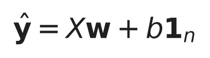
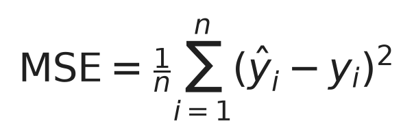
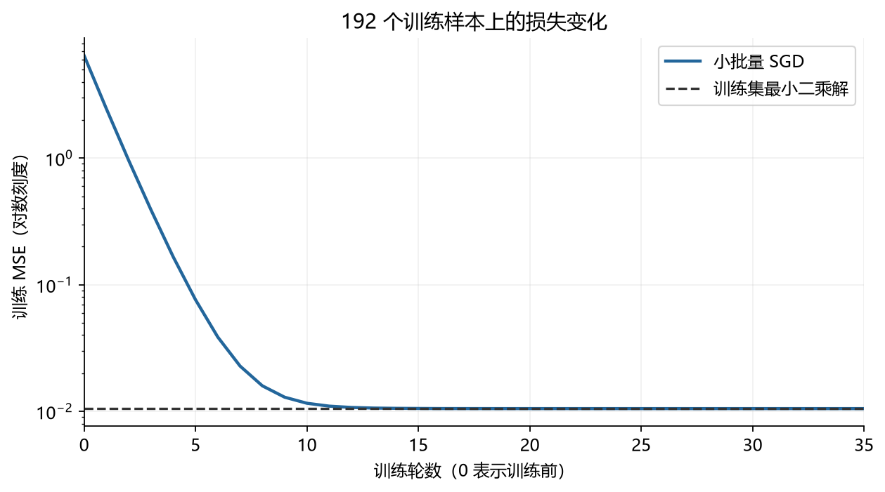
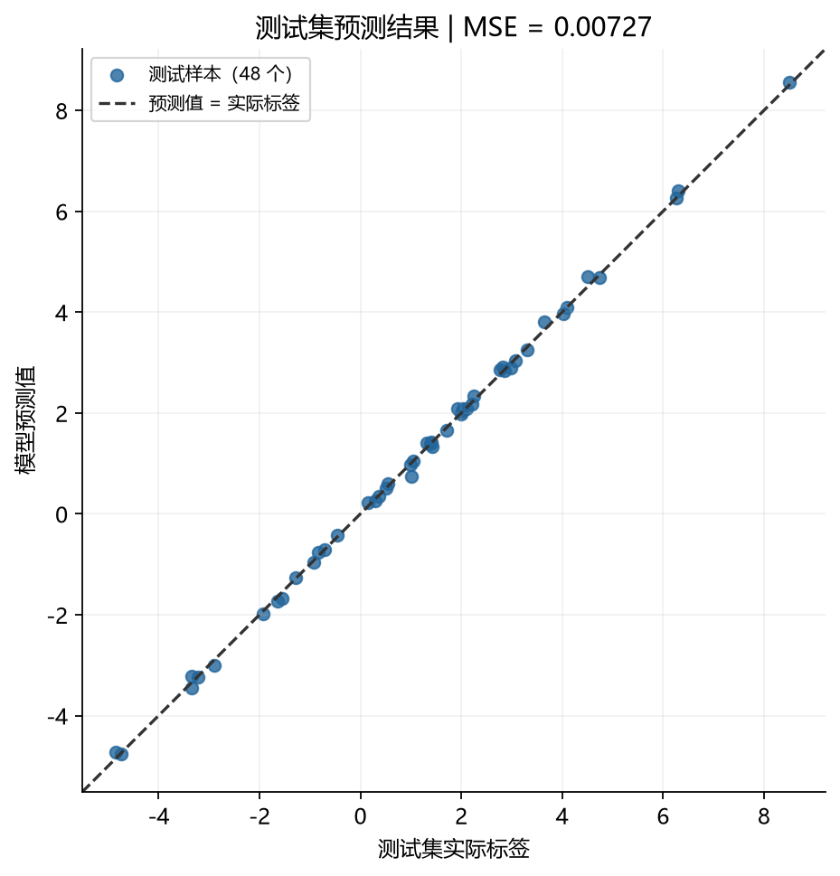
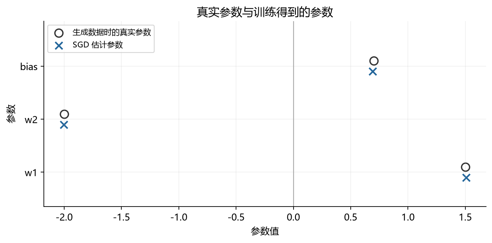
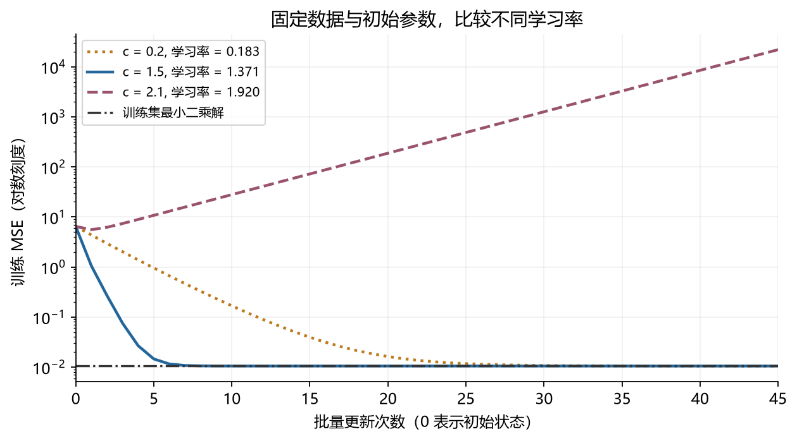

# 线性回归：从数学原理到代码实现

这是我学习《动手学深度学习》时整理的一个小项目。我想从线性回归开始，把数学公式和实际代码对应起来，再逐步尝试实际数据和自己的想法。

第一部分用自己生成的数据做实验：先设定真实权重和偏置，再让模型从带噪声的数据中学习，最后比较学到的参数和预测结果。

**[查看线性回归学习笔记](notebooks/01-foundations/linear_regression.ipynb)**

## 内容安排

1. **基础学习**：模型公式、梯度推导、合成数据和 PyTorch 实现。
2. **实际问题**：把模型用到具体的数据和问题中。
3. **优化与思考**：围绕实验中遇到的问题，提出想法并做对照。

## 第一部分做了什么

- 说明输入、权重、偏置和预测值的维度。
- 从均方误差出发，推导梯度下降的更新公式。
- 用解析公式和 PyTorch 自动求导核对同一批数据的梯度。
- 用 `nn.Linear` 和小批量 SGD 完成训练。
- 分开训练集和测试集，比较预测误差与真实参数。
- 固定其他条件，观察不同学习率下的训练曲线。

## 模型和实验设置

线性回归的预测公式是



输入矩阵 `X` 的维度是 `(n, d)`，每行是一个样本；权重向量 `w` 的维度是 `(d, 1)`；`b` 是偏置；预测值和标签的维度都是 `(n, 1)`。这次实验中，每个样本有两个特征。

用均方误差衡量预测和实际标签的差距：



训练时使用 MSE 的一半，方便求导；下面展示的数值和图表统一使用 MSE。具体推导放在 Notebook 中。

| 设置 | 数值 |
|---|---|
| 数据 | 240 个合成样本，2 个标准正态分布特征 |
| 真实权重 | `(1.5, -2.0)`，按列向量使用 |
| 真实偏置 | 0.7 |
| 噪声 | 独立高斯噪声，标准差 0.1 |
| 数据划分 | 192 个训练样本，48 个测试样本 |
| 训练 | 零初始化，学习率 0.08，批量大小 32，35 轮 |
| 随机种子 | 数据 41，划分 43，批次顺序 42 |

测试集不参与参数更新，也不用来选择学习率或训练轮数。除了模型，还用“始终预测训练标签平均值”的简单方法作比较。

## 运行结果

下面的结果来自 Notebook 的一次完整运行。

| 指标 | 结果 |
|---|---:|
| 训练前的 MSE | 6.453194 |
| 训练后的 MSE | 0.010506 |
| 训练集最小二乘解的 MSE | 0.010505 |
| 测试集 MSE | 0.007269 |
| 训练均值基线的测试 MSE | 7.827028 |



训练误差逐渐下降，并接近最小二乘解对应的误差。这里和最小二乘解比较，是为了检查梯度下降是否接近这批训练数据上的最优解。



测试样本大多靠近对角线，说明预测值接近实际标签。这次测试 MSE 比训练均值基线小得多，但这只是对当前合成数据的结果。

| 参数 | 真实值 | 估计值 |
|---|---:|---:|
| `w1` | 1.500000 | 1.506014 |
| `w2` | -2.000000 | -2.002949 |
| `b` | 0.700000 | 0.692953 |



估计参数已经比较接近真实参数，但没有完全相等。有限样本中的噪声不会刚好抵消，训练过程本身也会有少量优化误差。

### 学习率对照

另外用同一训练集做了一个小实验：都从零开始，用批量梯度下降更新 45 次，只改变学习率。



图中的 `c` 是用来控制步长大小的系数。学习率等于 `c` 除以损失函数 Hessian 矩阵的最大特征值，具体定义和推导见 Notebook 第 7 节。
在这个实验中，较小的步长收敛慢一些，较大的稳定步长更快，而超过稳定范围的步长会发散。这个结论有具体条件，不能直接把这里的学习率用于其他模型。

## 怎样运行

使用 Python、PyTorch、NumPy、Matplotlib 和 JupyterLab，不需要 GPU 或额外下载数据。
本次运行环境是 Windows、Python 3.13.9、PyTorch 2.14.1+cpu，具体依赖版本见 `requirements.txt`。

下载项目后，在项目文件夹中打开终端。Windows 下可以执行：

```powershell
python -m venv .venv
.\.venv\Scripts\python.exe -m pip install -r requirements.txt
.\.venv\Scripts\python.exe -m jupyterlab
```

打开 `notebooks/01-foundations/linear_regression.ipynb`，选择对应的 Python 内核，然后点击 **Restart Kernel and Run All Cells（重启内核并运行全部单元格）**。

Notebook 已保留运行结果，也可以直接在 GitHub 上阅读。重新运行会更新 `figures/` 中的图片；修改实验设置后，README 的结果需要一起更新。其他系统可将命令中的 Python 路径换成 `.venv/bin/python`。如果中文图表字体缺失，需要安装或指定一个中文字体。

本次验证使用了已有环境，尚未单独测试全新环境的安装过程；不同版本和平台的数值也可能有细微差别。

## 文件结构

```text
├── README.md
├── requirements.txt
├── .gitignore
├── THIRD_PARTY_NOTICES.md
├── notebooks/
│   ├── 01-foundations/
│   │   └── linear_regression.ipynb
│   ├── 02-real-world-application/
│   └── 03-improvements-and-reflections/
└── figures/
```

## 这次实验能说明什么？

在这组数据上，模型学到了接近真实值的参数，也能较好地预测同分布的测试样本。代码中检查了数据划分、变量维度、梯度和参数更新，Notebook 可以从头顺序运行。

不过，训练损失下降不能单独证明泛化能力。这里的数据本来就是按线性关系生成的，只有两个特征、一次随机划分和 48 个测试样本。真实数据可能有异常值、特征相关性或非线性关系，还需要另外分析。噪声和样本数的影响在笔记中作了理论说明，这次没有专门做它们的对照实验。

## 参考与说明

主要参考《动手学深度学习》（Aston Zhang、Zachary C. Lipton、Mu Li、Alexander J. Smola）：

- [线性回归](https://d2l.ai/chapter_linear-regression/linear-regression.html)
- [合成回归数据](https://d2l.ai/chapter_linear-regression/synthetic-regression-data.html)
- [从零实现线性回归](https://d2l.ai/chapter_linear-regression/linear-regression-scratch.html)
- [线性回归的简洁实现](https://d2l.ai/chapter_linear-regression/linear-regression-concise.html)

这份笔记按学习过程重新组织，补充了测试集评估和一些对照，不是教材的逐字搬运。来源与许可见 [THIRD_PARTY_NOTICES.md](THIRD_PARTY_NOTICES.md)。

AI 辅助整理说明：本项目的笔记整理、代码完善和运行检查使用了 AI 辅助。
